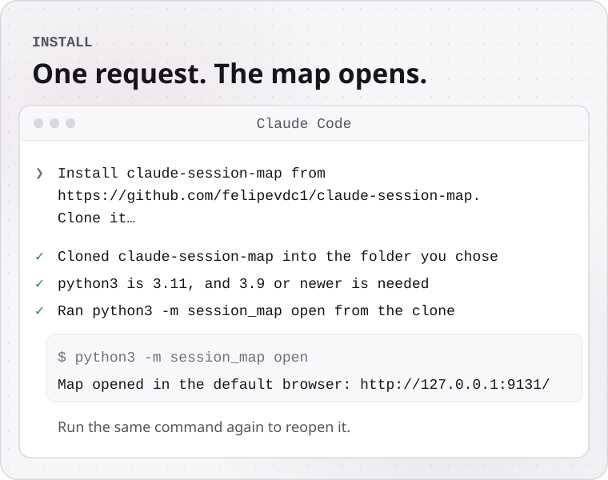
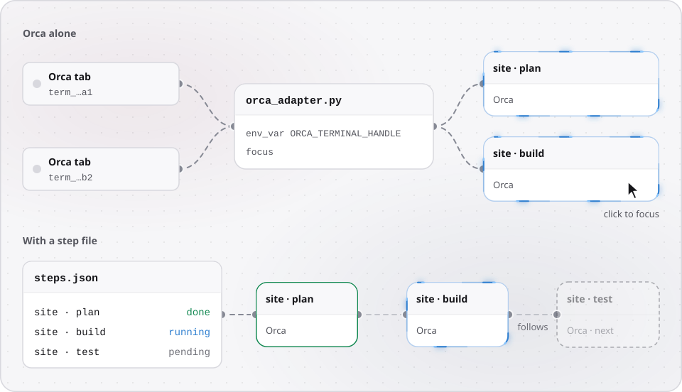

**English** · [Português](README.pt-BR.md)

<a id="top"></a>

<p align="center">
  <picture>
    <source media="(max-width: 600px) and (prefers-color-scheme: dark)" srcset="assets/en/hero-narrow-dark.svg" />
    <source media="(max-width: 600px)" srcset="assets/en/hero-narrow-light.svg" />
    <source media="(prefers-color-scheme: dark)" srcset="assets/en/hero-dark.svg" />
    
  </picture>
</p>

<h1 align="center">agent-session-map</h1>

<p align="center"><strong>See every AI coding session on your machine, live: Claude Code and Codex.</strong></p>

<p align="center"><sub>Formerly claude-session-map; the old address redirects here.</sub></p>

<p align="center">A live map of the AI coding agent sessions on one machine, Claude Code and Codex side by side, drawn as cards in a browser page.
Everything is read from disk and from local commands; no model is involved, and nothing leaves the machine.</p>

<p align="center">
  <a href="LICENSE"></a>
  
  
  
  
  
</p>

<p align="center"><a href="#install"><strong>Install</strong></a> · <a href="#how-it-works">How it works</a> · <a href="#commands">Commands</a> · <a href="#color-rule">The color rule</a> · <a href="#snapshot">Snapshot</a> · <a href="#orchestrators">Orchestrators</a> · <a href="#orca">Orca</a> · <a href="#sources">Adding another agent</a> · <a href="#requirements">Requirements</a></p>

<a id="install"></a>

## Install

Open **Claude Code** or **Codex** in any folder and paste this request.
It clones this repository, checks your Python and opens the map.

```text
Install agent-session-map from https://github.com/felipevdc1/agent-session-map. Clone it into a folder of my choice (ask me which), check that python3 is 3.9 or newer, then run python3 -m session_map open from the clone. Tell me the address the map opened at (http://127.0.0.1:9131/ unless SESSION_MAP_PORT is set), and that running the same command again reopens it.
```

<p align="center">
  <picture>
    <source media="(prefers-color-scheme: dark)" srcset="assets/en/install-dark.svg" />
    
  </picture>
</p>

When it finishes, the map is open in your browser (inside a Tern pane, beside it).
Run `python3 -m session_map open` again any time.

<details>
<summary><strong>Install from the terminal</strong></summary>

From a clone of this repository:

```
python3 -m session_map open
```

Or install it and use the `session-map` command:

```
pip install .
session-map open
```

</details>

<a id="what-it-is"></a>

## What it is

A live map of the AI coding agent sessions on one machine, Claude Code and Codex side by side, drawn as cards in a browser page.
Every live session is a card: Tern tabs, tabs an orchestrator opened, background sessions and sessions in any other terminal.
Codex sessions are cards too: a terminal `codex` (in a Tern pane or any other terminal) and the threads of the Codex desktop app, each marked with a small Codex tag.
The helpers (subagents) each session called get their own cards, and so does an orchestrator's next step that has not opened yet.
Lines show who opened, called or comes after whom, and one color rule says what each card is doing: working, waiting, done, stopped or closed.
Everything is read from disk and from local commands; no model is involved, and nothing leaves the machine.
It is Python 3.9+ standard library only, with one HTML page.

<a id="how-it-works"></a>

## How it works

<p align="center">
  <picture>
    <source media="(max-width: 600px) and (prefers-color-scheme: dark)" srcset="assets/en/how-it-works-narrow-dark.svg" />
    <source media="(max-width: 600px)" srcset="assets/en/how-it-works-narrow-light.svg" />
    <source media="(prefers-color-scheme: dark)" srcset="assets/en/how-it-works-dark.svg" />
    
  </picture>
</p>

### Where every piece comes from

Each source is read on its own; one that fails adds a line to the problems and the rest of the map still comes out.

**Claude Code**:

- **The session registry**: Claude Code keeps one file per running session, `~/.claude/sessions/<pid>.json`, with its session id, cwd, status (`idle`, `busy`, `waiting`, `shell`), what it waits for, its name and when its status last changed.
  A session is live when its process answers `os.kill(pid, 0)`.
- **The conversations**: `~/.claude/projects/<encoded cwd>/<sessionId>.jsonl`, under the folder of each session's own cwd.
  The map reads the conversation's titles (`custom-title`, `ai-title`), its last record, its last assistant text, the time of its last timestamped record, and the background commands it started that have not returned yet.
  Background commands are counted for every session, whatever its folder.
- **The helpers**: `~/.claude/projects/<encoded cwd>/<sessionId>/subagents/agent-*.meta.json` and the transcript `agent-*.jsonl` beside each one: whether the helper finished, its description, type, team and parent helper.
- **The process environment**: one `ps eww` over the live pids, run only for pids not seen before (a process's environment never changes).
  Only `TERN_PANE=<number>` and each adapter's handle variable are taken from each line, through anchored regexes; the rest of the line is dropped where it is read.
- **Tern**: `tern ls --json` (only when some session has a Tern pane) gives each live pane's tab number and title.
  `tern` is found at `~/.local/bin/tern`, else on `PATH`.
- **Orchestrators**: the adapters named in `SESSION_MAP_ADAPTERS` (see "Extension point").

**Codex** (its folder is `$CODEX_HOME`, else `~/.codex`; `SESSION_MAP_CODEX_DIR` replaces both):

- **The rollouts**: `<codex folder>/sessions/YYYY/MM/DD/rollout-*.jsonl`, one file per thread.
  Only the first line's header counts (`session_meta`: the thread id, its folder, which program wrote it and, for a helper, its parent and nickname); the second header a forked rollout carries is ignored.
  The map parses only the lines that hold a turn's settings (the approval policy and who reviews approvals), a turn's start or end, a tool call, or a message from you; a tool call's result line gives only its call id, taken by a regex, and is never parsed.
  Only rollouts changed in the last 8 hours are read, plus any a live terminal Codex may still be writing.
- **The thread names**: `<codex folder>/session_index.jsonl`, the last name given to each thread.
- **The processes**: one `ps -axo pid=,ppid=,etime=,comm=` per snapshot; only the pid, the parent pid, the elapsed time and whether the program is `codex` or the ChatGPT app leave each line.
  Then one `ps eww` over the terminal Codex processes not seen before, from which only `PWD=` and `TERN_PANE=` are taken (the last match of each, so a prompt that types `PWD=` never wins), and whether the first argument is `app-server`; the rest of every line is dropped where it is read.
  A terminal Codex is a process named `codex` none of whose parents is the ChatGPT app or another `codex`, and whose first argument is not `app-server` (the background server a terminal Codex starts, which outlives it).
  The desktop app is alive while the ChatGPT app's own process runs.
- **Tern**: a Codex card in a Tern pane takes its tab number from the same `tern ls --json`.

A run that points the Claude Code reader at fixtures (`SESSION_MAP_REGISTRY_DIR`, `SESSION_MAP_PROJECTS_DIR` or `SESSION_MAP_PS_JSON` set) and does not set `SESSION_MAP_CODEX_DIR` reads no Codex at all, so a test run never mixes your real Codex threads into its fixtures.
A missing `sessions` folder (Codex not installed) is an empty source, not a problem.
When `ps` fails for Codex the problems say only `codex: ps did not answer`.

The map reads each conversation incrementally: a file whose size, modification time and inode have not changed is not read at all, a file that grew is read only from where the last read stopped, and the last utterance comes from at most the last 64 KiB (2 MiB when that window lacks it).
Codex's rollouts and thread names are read the same incremental way, so a second snapshot over unchanged files reads nothing, however large the rollouts grow.

A session card's title is the first of these that exists: the name the person gave the session, the conversation's last custom title, its last AI title, the Tern tab's title (Tern cards only), the name Claude Code derived, else "unnamed session".
An orchestrated card takes its step's label instead.
A Codex card's title is the thread's last name in `session_index.jsonl`, else "unnamed session"; a Codex helper's is its nickname, else "helper".
Every title is cleaned: the spinner sign in front is dropped, it is one line, home paths, UUIDs and `KEY=value` pairs become `…`, and it is cut to 80 characters.

<a id="commands"></a>

## Commands

`open` reuses the map's server if it is already running, or starts one in the background, then opens the page.
Inside a Tern pane it opens the page in a browser block beside that pane; anywhere else it opens the default browser (`open` on macOS, `xdg-open` elsewhere).

The other commands:

```
session-map snapshot              # print the snapshot as JSON
session-map snapshot --problems   # print only the texts of the sources that failed ("no problems" when none)
session-map prototype --out map.html   # write the page with the snapshot of now embedded (default ./prototype.html)
session-map serve                 # run the server in the foreground
```

Exit codes: 0 ok, 1 error, 2 bad arguments.
No command prints a traceback.

<a id="settings"></a>

## Settings

Settings, all optional:

| Variable | What it does | Default |
|---|---|---|
| `SESSION_MAP_PORT` | the server's port | `9131` |
| `SESSION_MAP_IDLE_S` | the server exits after this many seconds with no request for `/state` | `600` |
| `SESSION_MAP_PAGE` | serve this HTML file instead of the packaged page | the packaged `page.html` |
| `SESSION_MAP_ADAPTERS` | orchestrator adapters to load (see "Extension point") | none |
| `SESSION_MAP_DONE_LINES` | turn markers that mean done (see "The color rule") | empty |
| `SESSION_MAP_WAIT_MARKS` | turn markers that mean waiting (see "The color rule") | empty |
| `SESSION_MAP_REGISTRY_DIR` | read the session registry from this folder | `~/.claude/sessions` |
| `SESSION_MAP_PROJECTS_DIR` | read conversations from this folder | `~/.claude/projects` |
| `SESSION_MAP_PS_JSON` | a JSON list of `ps` lines read instead of running `ps` (for tests) | none |
| `SESSION_MAP_TERN_JSON` | a file read instead of running `tern ls --json` (for tests) | none |
| `SESSION_MAP_STEPS_FILE` | the step file of the example Orca adapter (see "Adding Orca to your workflow") | none |
| `SESSION_MAP_SOURCES` | the session sources to read, a comma-separated list of `claude` and `codex`; `claude` is always read, and an unknown name adds a problem line (see "Adding another agent") | `claude,codex` |
| `SESSION_MAP_CODEX_DIR` | read Codex's files from this folder (it also keeps the Codex source on in a run that points the Claude Code reader at fixtures) | `$CODEX_HOME`, else `~/.codex` |
| `SESSION_MAP_CODEX_PS_JSON` | a JSON file, `{"comm": [...], "env": [...]}`, of the lines of the two Codex `ps` commands, read instead of running them (for tests) | none |

`CLAUDE_CONFIG_DIR`, when set, replaces `~/.claude` as the base of the two default folders, as it does for Claude Code itself.
`CODEX_HOME`, when set, replaces `~/.codex`, as it does for Codex itself.

<a id="color-rule"></a>

## The color rule

**For Claude Code sessions.**
A session's state is decided by one rule, read top to bottom; the first signal that exists decides.

1. No registry entry, or its process is dead: **closed**.
2. Registry status `waiting`: **waiting**, with what it waits for in words (`waiting_for`): `input needed` is "question or form", anything mentioning a permission or a request is "permission request", a dialog is "dialog open", anything else is "your decision".
3. Registry status `busy`: **working**, unless the conversation (or one of its helpers' transcripts) has had no timestamped record for more than 15 minutes, which is **stopped** (stuck).
   The registry's status time does not move during a long busy run, so the last timestamped record of the conversation is the clock, never the file's modification time.
4. An orchestrator's verdict for the step whose current tab this session is: `done` is **done**, `closed` is **closed**, `waiting` is **waiting**.
5. The turn ended (the last record is a `system` record of subtype `turn_duration`):
   - background work still going (a helper the turn left pending, or a background command with no return notice yet) is **working**, bounded like busy: untouched for more than 15 minutes is **stopped**;
   - no assistant text is **stopped**;
   - a last line equal to one of the done lines is **done**;
   - any of the wait marks anywhere in the last text is **waiting**;
   - a question in the last three lines (a `?` at the end of a line, closing marks allowed after it, or a whole parenthesis holding a `?`) is **waiting**, with `guessed: true`;
   - anything else is **done**.
6. Anything else (a user record after the end, an assistant record with no end, nothing yet): **stopped**.

The statuses `idle` and `shell` (a turn that ended with a background shell still alive) go straight to rules 4 to 6, and so does any status the map does not know (it also adds a problem line).

`guessed` marks the one state that comes from how the last message is worded rather than from a sure signal; the page shows it and says to trust it a little less.

**Helpers** have their own rule.
A helper whose meta says `finished` is **done**, and leaves the map 10 minutes after its meta last changed.
An unfinished helper is **working** until it falls silent (neither its meta nor its transcript changed): silent for more than 5 minutes while its session is not busy, it is **closed**; silent for more than 15 minutes it leaves the map, whatever its session is doing.

**For Codex sessions.**
A Codex thread is one rollout file, and its card goes through its own rule, read the same way, top to bottom:

1. Not live: no card at all, like a dead Claude Code session.
   A terminal thread is live when a running terminal Codex was launched in the thread's folder (its `PWD`) and started before the thread's last record; when several threads match one process, only the one written most recently is live.
   A desktop app thread is live while the ChatGPT app runs.
2. A question to you (the `request_user_input_async` call) in the open turn, with no message from you after it: **waiting**, "question or form", with `inferred: true`.
3. A turn is open (it started and has not ended):
   - a command that asked for escalated permissions has had no result for more than 3 seconds, under an approval policy that asks you (`on-request` or `untrusted`) with you as the reviewer: **waiting**, "permission request", with `inferred: true`;
   - else nothing was written for more than 15 minutes: **stopped** (stuck);
   - else **working**, since the turn started.
4. The turn completed: with an error, **stopped**; else its last agent message goes through the same tail rule as rule 5 above (no text is **stopped**, the done lines, the wait marks, a question in the last three lines is **waiting** with `guessed: true`, anything else is **done**).
5. The turn was interrupted: **stopped**.
6. Anything else (a header only, nothing yet): **stopped**.

Codex does not write a permission request to disk, so a Codex card's yellow for a permission is inferred from a command that needs approval and has no result yet; the snapshot marks it `inferred: true` and the page says so.
Codex does not write whether a question is still open either (the question call is acknowledged at once, and your answer arrives as your next message), so the question wait is inferred too: your next message, or the end of the turn, clears it.
`inferred` is a different reason to trust a color a little less than `guessed`, and the page says which one applies.

**Codex helpers**: a thread a Codex session spawned (a subagent) is a helper card under its parent, with a `called` line, where `Codex helper`.
It is **working** while a turn is open, **done** after its last turn completed (**closed** after an interrupted one), and leaves the map 10 minutes after its file last changed; an unfinished one that falls silent follows the helper rule above (5 and 15 minutes).
The automatic approvals reviewer Codex runs as a helper (the guardian) is never a card.

**Next**: an orchestrator's step that has not opened yet is a dashed card in the state **next**.

**Hidden**: a session card that is done or stopped and has not changed for more than 8 hours is left out of the map with its helpers; the snapshot counts them in `hidden_n`, and the page's footer says how many.
The same holds for Codex cards.

**Vanished sessions**: the server keeps a session or helper that disappeared from the registry on the map as **closed** for 10 minutes, then drops it.
A Codex card whose process is gone (or whose app quit) is kept the same way.
A one-off `session-map snapshot` has no memory of earlier runs, so it never shows those.

On the page, working cards glow blue, waiting is yellow, done is green, stopped is grey, closed is a faded green, and next is dashed.

**Optional turn markers.**
If your sessions end their turns with fixed lines, the map can use them in rule 5.
`SESSION_MAP_DONE_LINES` is a `|`-separated list of lines that mean done when one is the last line of the turn (leading and trailing `*`, `_` and spaces are ignored); `SESSION_MAP_WAIT_MARKS` is a `|`-separated list of strings that mean waiting when one appears anywhere in the last text.
Both are empty by default.

```
SESSION_MAP_DONE_LINES="All done.|Finished." SESSION_MAP_WAIT_MARKS="[needs you]" session-map snapshot
```

<a id="snapshot"></a>

## The snapshot schema

`session-map snapshot` prints the snapshot as JSON, and `GET /state` serves the same object.
This JSON is the integration contract: a Tern plugin in any language can call the CLI and draw it itself.
See `examples/example.json` for a full one.

Top level:

| Key | Value |
|---|---|
| `version` | 12 hex characters: a sha256 of everything except `version` and `generated_at`, so it changes only when the map changes (the server's `ETag`) |
| `generated_at` | local time, ISO 8601 with offset, to the second |
| `nodes` | the cards (below) |
| `lines` | the lines between cards (below) |
| `problems_n` | how many sources failed (`session-map snapshot --problems` prints their texts) |
| `hidden_n` | how many done or stopped cards the 8-hour rule left out |
| `unknown_format` | present, and `true`, only when the session registry looks unlike the format the map knows |

A node:

| Key | Value |
|---|---|
| `id` | `p:<pid>` for a Claude Code session, `x:<12 hex>` for a Codex session, `a:<8 hex>` for a helper (of either), `n:<adapter index>:<12 hex>` for a next step |
| `agent` | present, and `codex`, only on Codex cards; a Claude Code card has no `agent` key |
| `kind` | `tern`, `orchestrated`, `background`, `other`, `app` (a Codex desktop app thread), `helper` or `next` |
| `title` | the card's title (cleaned, at most 80 characters) |
| `where` | `Tern · tab <n>` (or `Tern`), the adapter's name, `in the background`, `other terminal`, for a helper `team <name>` or its agent type, for a next step `<adapter name> · next`; for Codex `Codex · Tern · tab <n>` (or `Codex · Tern`), `Codex · other terminal`, `Codex app`, `Codex helper` |
| `state` | `working`, `waiting`, `done`, `stopped`, `closed` or `next` |
| `since` | local ISO time the state holds since, or `null` |
| `pane` | Tern cards only: the Tern pane number |
| `waiting_for` | waiting from the registry, or a Codex wait: `question or form`, `permission request`, `dialog open` or `your decision` (a Codex card only ever has the first two) |
| `guessed` | present, and `true`, only when the state was guessed from the last sentence |
| `inferred` | present, and `true`, only on a Codex card waiting on a permission or a question, which Codex does not write to disk (see "For Codex sessions") |

The kinds, in the order the map decides them: `orchestrated` (an adapter claimed the session), `background` (registry kind `bg`, or running in tmux), `tern` (it has a Tern pane), `other` (none of these); then `helper` and `next`.
A Codex card is `tern` (its process has a Tern pane), `other` (a terminal Codex outside Tern) or `app` (a desktop app thread); a Codex helper is `helper`.

A line:

| Key | Value |
|---|---|
| `from` | a node id |
| `to` | a node id |
| `kind` | `opened` (a step's manager session opened this session), `called` (a session or helper called this helper), `follows` (a next step comes after this card) |

Both ends of every line are nodes of the same snapshot.
The snapshot never holds a path, a UUID, a session id, a terminal handle or a `KEY=value` pair.
For Codex that also means no thread id, no folder and no message text: a Codex card's id is a hash, and its title is the cleaned thread name.

<a id="orchestrators"></a>

## Extension point: orchestrators

An orchestrator is a tool that opens Claude sessions in its own terminal tabs.
It plugs into the map through an adapter, defined in `session_map/orchestrator.py`:

```python
@dataclass(frozen=True)
class Tab:
    session_id: Optional[str]  # Claude sessionId of the session running in this tab
    handle: Optional[str]      # the orchestrator's own terminal id (matched against env_var in ps)

@dataclass(frozen=True)
class Step:
    key: str                   # stable, unique per adapter, [A-Za-z0-9_.-]{1,80}
    label: str                 # card title, e.g. "site · plan"
    tabs: Tuple[Tab, ...]      # oldest first; the last one is the current tab
    verdict: Optional[str] = None   # "done" | "waiting" | "closed" | None (None = let the core decide)
    pending: bool = False      # True = the step has not opened yet, shown as a dashed "next" card
    depends_on: Tuple[str, ...] = ()   # keys of steps this one follows
    manager_session_id: Optional[str] = None  # the session that opened it, shown as an "opened" line

class Adapter(Protocol):
    name: str                  # shown in the card's "where", e.g. "Orca"
    env_var: Optional[str]     # e.g. "ORCA_TERMINAL_HANDLE"
    env_pattern: Optional[str] # the value's regex, e.g. r"term_[0-9a-f-]+"
    def steps(self, live_session_ids: Set[str], live_handles: Set[str]) -> List[Step]: ...
    def focus(self, handle: str) -> bool: ...  # bring that tab to the front; True on success
```

**Loading.**
`SESSION_MAP_ADAPTERS` lists adapters as comma-separated `module:attr` entries, where `module` is a dotted importable module name or a path to a `.py` file, and `attr` is the adapter object in it.
An adapter is checked when it loads: `name` must be a non-empty string, `env_var` and `env_pattern` are both strings or both `None`, `env_var` must look like an environment variable name, `env_pattern` must compile, and `steps` and `focus` must be callable.
An entry that fails to import or to pass the check becomes one problem line and is skipped; it never stops the map.
Adapters are imported once per value of `SESSION_MAP_ADAPTERS` in a process.

**Handles.**
When an orchestrator sets an environment variable in every tab it opens, the map reads it from each session's process environment: `env_var` and `env_pattern` compile to `(?:^|\s)<env_var>=(<env_pattern>)(?:\s|$)`, and a value must also match `^[A-Za-z0-9_-]{1,80}$` before any adapter sees it.
The handles found for live sessions are passed to `steps` as `live_handles`, and the live session ids as `live_session_ids`.
Handles are used only for matching and focus; they never enter the snapshot.

**Matching.**
Each step is matched to the live sessions, adapter by adapter in the order they are listed.
The step's current tab (the last of `tabs`) matches by handle first, then by session id; older tabs match by session id only.
A matched session becomes `orchestrated`, its `where` is the adapter's name and its title is the step's label.
Only the session matched to the current tab takes the step's verdict (rule 4); one matched through an older tab keeps its own state.
When the step's `manager_session_id` is a live session, an `opened` line runs from it to each matched session.

**Pending steps.**
A step with `pending=True` and no tabs becomes a `next` card, shown when its manager session is live or a step it depends on is on the map.
Its `follows` lines come from the cards of the steps in `depends_on` (the session of that step's current tab, else its own next card), or, with none of those, from the manager's card.
A `key` is part of node ids and problem lines, so never use a handle or a session id as a key.

**Validation.**
`steps` runs inside a guard: if it raises, or does not return a list, that adapter adds one problem line and the rest of the map comes out.
A step that is not a `Step`, or has a bad key, verdict, label, tabs or `depends_on`, is dropped with a problem line, and so is a second step with a key already seen.

**Problems from the adapter.**
An adapter may have a `problems` attribute: a list of strings, refreshed by each `steps()` call, for trouble that should not stop it.
After each `steps()` call the map adds each string to the snapshot's problems as `adapter <name>: <text>`.

**Focus.**
When the page asks to bring an orchestrated card to the front, the server finds the handle from that session's process environment, else the current tab handle of the step it was matched to, and calls `adapter.focus(handle)`.

A minimal adapter (it has no handle variable and labels nothing; it puts one pending step after the session whose id you give it):

```python
# my_adapter.py
import os
from session_map.orchestrator import Step

class MyAdapter:
    name = "My orchestrator"
    env_var = None       # or the variable your tool sets in each tab it opens
    env_pattern = None   # and the regex of its value

    def steps(self, live_session_ids, live_handles):
        manager = os.environ.get("MY_MANAGER_SESSION_ID")
        return [Step(key="review", label="site · review", tabs=(), pending=True, manager_session_id=manager)]

    def focus(self, handle):
        return False     # ask your tool to bring the tab to the front; True on success

adapter = MyAdapter()
```

```
SESSION_MAP_ADAPTERS=my_adapter.py:adapter session-map snapshot --problems
```

`MY_MANAGER_SESSION_ID` is this example's own variable, not one the map reads.
The `next` card appears only while that session is live.

<a id="orca"></a>

## Adding Orca to your workflow

<p align="center">
  <picture>
    <source media="(max-width: 600px) and (prefers-color-scheme: dark)" srcset="assets/en/orca-narrow-dark.svg" />
    <source media="(max-width: 600px)" srcset="assets/en/orca-narrow-light.svg" />
    <source media="(prefers-color-scheme: dark)" srcset="assets/en/orca-dark.svg" />
    
  </picture>
</p>

Each piece Orca or your orchestrator can give the map, and where it plugs in here:

| What you want | Where it comes from | Where it plugs in here |
|---|---|---|
| each tab's terminal handle | `ORCA_TERMINAL_HANDLE` (set by Orca) | `Adapter.env_var` / `env_pattern` |
| bringing a tab to the front | `orca terminal switch --terminal <handle> --json` | `Adapter.focus` |
| the tab's title | `orca terminal list --json` | `Step.label` (layer 1 of the example) |
| a next step that has not opened yet | your orchestrator's own plan state | `Step(pending=True, depends_on=…)` → a dashed "next" card |
| your orchestrator's verdict on a step (done, waiting, closed) | your orchestrator's own state | `Step.verdict` → rule 4 |
| who opened the tab | your orchestrator's manager session id | `Step.manager_session_id` → an "opened" line |

`examples/orca_adapter.py` does this in two layers.
Layer 1 runs `orca terminal list --json` (`orca` from `PATH`, else `/Applications/Orca.app/Contents/Resources/bin/orca`) and makes one step per connected terminal, labelled with its Orca title, so Orca tabs get their titles and become clickable; its `focus` runs `orca terminal switch --terminal <handle> --json`, then brings Orca to the front on macOS.
Layer 2 reads the file `SESSION_MAP_STEPS_FILE` names, shaped like `examples/steps.example.json`: a list of steps with `key`, `label`, `state`, `depends_on`, `manager_session_id` and `tabs` (each with `session_id` and `handle`).
Its states map to steps as `pending` (a next card), `running` (no verdict), `done`, `waiting` and `closed` (those verdicts); its steps replace layer 1's for the same handles.
A step file that does not parse becomes one problem line, and layer 1 keeps working.

Orca alone gives you layer 1 (titles and click-to-focus); the pending steps and verdicts need an orchestrator that writes them: point `SESSION_MAP_STEPS_FILE` at a file your plugin writes, or write your own adapter.

From the repository folder:

```
SESSION_MAP_ADAPTERS=examples/orca_adapter.py:adapter session-map open
```

<a id="sources"></a>

## Adding another agent

Each kind of agent the map draws is a session source, defined in `session_map/sources/__init__.py`:

```python
@dataclass(frozen=True)
class Context:
    now: float                  # epoch seconds of this snapshot
    config: object              # the turn markers (SESSION_MAP_DONE_LINES, SESSION_MAP_WAIT_MARKS)
    problems: list              # append short texts that never hold a path
    tabs: Callable[[], dict]    # the Tern tabs: `tern ls` at most once per snapshot, call it only when needed

@dataclass
class SourceResult:
    nodes: list                 # this source's cards, drawn after the sources before it
    lines: list                 # its lines; both ends must be nodes of the snapshot
    hidden_n: int = 0           # cards the 8-hour rule left out
    hidden: set = field(default_factory=set)  # their ids
    unknown_format: bool = False

class Source(Protocol):
    name: str                   # shown in a problem line, e.g. "Codex"
    def read(self, ctx: Context) -> SourceResult: ...
```

**Registering.**
A source is code inside `session_map/sources/`, listed in `BUILTIN` and built by `selected()` in that same file; it is not loaded from a path the way orchestrator adapters are.
A source reads private files on your machine, so it ships reviewed with the package: `tests/test_sources_structure.py` runs the same no-network, no-stray-program check as the rest of the package over every file in that folder, and pins the list of files.
`SESSION_MAP_SOURCES` picks which built-in sources run; the map always draws them in the built-in order, Claude Code first.

**The contract every source keeps.**

- No path, id or message text in a node: ids are hashes (a Codex card is `x:` and the first 12 hex characters of the sha256 of its thread id), and titles go through the same cleaning as Claude Code's.
- The same five states, decided by a rule written down like the ones above; a state that comes from wording or from an inference carries `guessed` or `inferred`.
- Isolation: Claude Code is read first, and every other source runs inside a guard, so one that raises adds `source <name>: failed (<error type>)` to the problems and the rest of the map still comes out.
- Problem texts never hold a path (the core also blanks any disk path in them).
- Incremental reads: a second snapshot over unchanged files reads nothing.
- Lines only between nodes of the same snapshot; any other line is dropped.

Gemini CLI or any other agent plugs in the same way; only Claude Code and Codex are built in today.

<a id="tern"></a>

## Embedding in a Tern plugin

- Run `session-map open` inside a Tern pane: the page opens in a browser block beside that pane.
- Or run `session-map serve` and point a browser block at `http://127.0.0.1:9131/`.
- Or read the snapshot yourself from `GET /state` (or from `session-map snapshot`) and draw it your own way.

The server's routes:

- `GET /` serves the page.
- `GET /state` serves the snapshot, recomputed at most once a second, with `ETag: "<version>"`; a request whose `If-None-Match` holds that version gets `304`.
- `POST /focus` with the JSON body `{"id": "<node id>"}` brings that card's tab to the front: `tern focus <pane>` for a Tern card, the adapter's `focus` for an orchestrated one; it answers `{"ok": true|false, "message": "..."}`.
- Anything else is `404`; `HEAD` and the other methods are `405`.

Behaviour and safety:

- The server listens on `127.0.0.1` only.
- Every request must carry `Host: 127.0.0.1:<port>` or `Host: localhost:<port>`, else `403` (this blocks DNS rebinding).
- `POST /focus` also needs an `Origin` header equal to the server's own origin (`http://127.0.0.1:<port>` or `http://localhost:<port>`), else `403`, and `Content-Type: application/json`, else `415`; the body must be 1 to 1024 bytes.
- `/focus` trusts nothing from the client but the node id: the card is looked up in the server's own latest snapshot, and the pane or handle comes from the server's side.
- Nothing is logged; the server started by `open` sends its output to the null device.
- The server exits by itself once nobody has asked for `/state` for `SESSION_MAP_IDLE_S` seconds (600 by default); `session-map open` starts it again.
- `open` reuses a server only when its `Server:` header says it is this map; if another program holds the port, it says so and stops.
  That header still reads `claude-session-map`, so a map server started before the rename is still recognised.

## Cost

- The page asks for `/state` every 2 seconds, and only while it is visible and someone touched it in the last 5 minutes; otherwise it pauses until the next click, key or mouse move.
- An unchanged map answers `304` with no body.
- Conversations are read incrementally (see "Where every piece comes from"), and `ps` runs only for sessions not seen before.
- The Codex source runs one `ps -axo` per snapshot and `ps eww` only for Codex processes not seen before, and reads rollouts incrementally too.
- When the server does not answer, the page backs off (4, 8, 16 seconds and so on, up to 60).

## Limits

- The session registry, the conversation files and the helpers' meta files are internal formats of Claude Code and may change; when the registry looks unlike the known format, the snapshot sets `unknown_format` and the page's footer says so.
- The page has no drag and no zoom; the layout is automatic.
- A Tern pane is tied to its session only through the registry pid and `TERN_PANE`.
- Codex's rollouts and `session_index.jsonl` are internal formats of Codex and may change between versions; the reader skips records it does not know, and a file with lines it cannot read adds one problem line.
- A Codex desktop app thread counts as live while the ChatGPT app runs; that is not measured per thread, because Codex leaves no per-thread sign of life on disk, so a desktop thread stays on the map until the 8-hour rule hides it or the app quits.
- The Codex desktop app was not tested live: its threads were read from disk only, and only the terminal Codex was measured running.
- A terminal Codex is matched to its thread by the folder it was launched in (`PWD`): a Codex told to work in another folder than that one gets no card, and two terminal Codex sessions launched in the same folder are told apart only by which thread each wrote last.
- A Codex session in an orchestrator's tab is shown as a Codex card, not matched to the orchestrator's step: adapters match Claude Code sessions only.
- After `codex resume`, the card comes back once the resumed session writes its first new record.
- A Codex card in a Tern pane shows its tab, but the page's "go to session" button works on Claude Code cards only.
- The tests replace `ps`, `tern` and `orca` with fixtures and fakes; Linux is not tested.

<a id="requirements"></a>

## Requirements

| Requirement | What works |
|---|---|
| Python | Python 3.9 or newer, no dependencies. |
| macOS | macOS is the tested platform. |
| Linux | Linux is likely to work (`ps eww` exists there, and `xdg-open` replaces `open`) but is not tested. |
| Windows | Windows is not supported: the map finds a session's Tern pane by reading the process environment with `ps eww`, and the standard library has no Windows equivalent. |
| Tern | Tern is optional; without it the map still shows every session, as "other terminal". |

<details>
<summary><strong>Run the tests</strong></summary>

```
python3 -m unittest discover -s tests
```

The page's layout tests need Node; without it they are skipped.

</details>

## Credits

Designed and first built by Felipe Vieira Domingues Carneiro (github.com/felipevdc1) for his own setup; this repository is the standalone, open-source port.

## License

MIT; see `LICENSE` and `NOTICE.md`.

Made by Felipe Carneiro: GitHub [felipevdc1](https://github.com/felipevdc1) · Instagram [@o.felipecarneiro](https://instagram.com/o.felipecarneiro).
