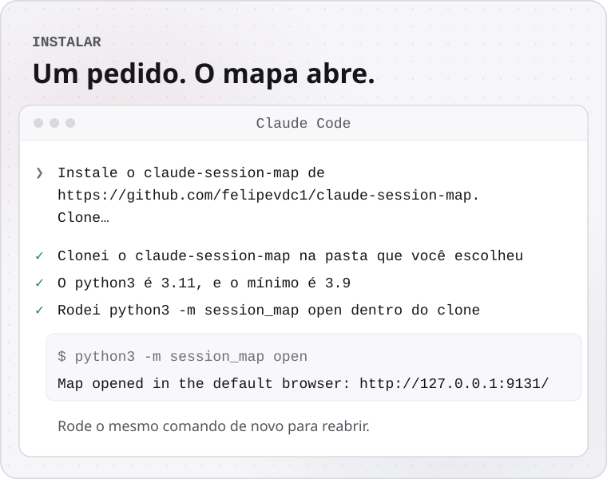
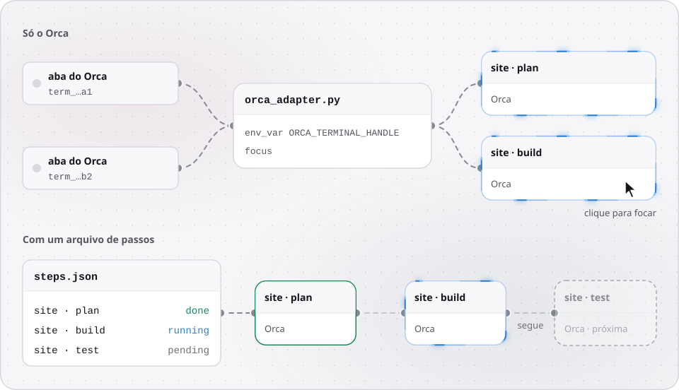

[English](README.md) · **Português**

<a id="top"></a>

<p align="center">
  <picture>
    <source media="(max-width: 600px) and (prefers-color-scheme: dark)" srcset="assets/pt-BR/hero-narrow-dark.svg" />
    <source media="(max-width: 600px)" srcset="assets/pt-BR/hero-narrow-light.svg" />
    <source media="(prefers-color-scheme: dark)" srcset="assets/pt-BR/hero-dark.svg" />
    
  </picture>
</p>

<h1 align="center">claude-session-map</h1>

<p align="center"><strong>Veja ao vivo todas as sessões do Claude Code na sua máquina.</strong></p>

<p align="center">Um mapa ao vivo das sessões do Claude Code de uma máquina, desenhadas como cartões numa página do navegador.
Tudo é lido do disco e de comandos locais; nenhum modelo entra no processo, e nada sai da máquina.</p>

<p align="center">
  <a href="LICENSE"></a>
  
  
  
  
</p>

<p align="center"><a href="#instalar"><strong>Instalar</strong></a> · <a href="#como-funciona">Como funciona</a> · <a href="#comandos">Comandos</a> · <a href="#regra-das-cores">A regra das cores</a> · <a href="#snapshot">Snapshot</a> · <a href="#orquestradores">Orquestradores</a> · <a href="#orca">Orca</a> · <a href="#requisitos">Requisitos</a></p>

<a id="instalar"></a>

## Instalar

Abra o **Claude Code** em qualquer pasta e cole este pedido.
Ele clona este repositório, confere o seu Python e abre o mapa.

```text
Instale o claude-session-map de https://github.com/felipevdc1/claude-session-map. Clone numa pasta que eu escolher (me pergunte qual), confira se o python3 é 3.9 ou mais novo e depois rode python3 -m session_map open a partir do clone. Me diga em que endereço o mapa abriu (http://127.0.0.1:9131/, a menos que SESSION_MAP_PORT esteja definida) e que rodar o mesmo comando de novo o reabre.
```

<p align="center">
  <picture>
    <source media="(prefers-color-scheme: dark)" srcset="assets/pt-BR/install-dark.svg" />
    
  </picture>
</p>

Quando terminar, o mapa estará aberto no seu navegador (dentro de um painel do Tern, ao lado dele).
Rode `python3 -m session_map open` de novo quando quiser.

<details>
<summary><strong>Instalar pelo terminal</strong></summary>

A partir de um clone deste repositório:

```
python3 -m session_map open
```

Ou instale e use o comando `session-map`:

```
pip install .
session-map open
```

</details>

<a id="o-que-e"></a>

## O que é

Um mapa ao vivo das sessões do Claude Code de uma máquina, desenhadas como cartões numa página do navegador.
Cada sessão viva é um cartão: abas do Tern, abas que um orquestrador abriu, sessões em segundo plano e sessões em qualquer outro terminal.
Os ajudantes (subagentes) que cada sessão chamou ganham cartões próprios, e a próxima etapa de um orquestrador que ainda não abriu também.
Linhas mostram quem abriu, chamou ou vem depois de quem, e uma regra de cores diz o que cada cartão está fazendo: trabalhando, esperando, pronto, parado ou encerrado.
Tudo é lido do disco e de comandos locais; nenhum modelo entra no processo, e nada sai da máquina.
É só biblioteca padrão do Python 3.9+, com uma página HTML.

<a id="como-funciona"></a>

## Como funciona

<p align="center">
  <picture>
    <source media="(max-width: 600px) and (prefers-color-scheme: dark)" srcset="assets/pt-BR/how-it-works-narrow-dark.svg" />
    <source media="(max-width: 600px)" srcset="assets/pt-BR/how-it-works-narrow-light.svg" />
    <source media="(prefers-color-scheme: dark)" srcset="assets/pt-BR/how-it-works-dark.svg" />
    
  </picture>
</p>

### De onde vem cada peça

Cada fonte é lida por conta própria; uma que falha acrescenta uma linha aos problemas, e o resto do mapa sai mesmo assim.

- **O registro de sessões**: o Claude Code mantém um arquivo por sessão em execução, `~/.claude/sessions/<pid>.json`, com o id da sessão, o cwd, o status (`idle`, `busy`, `waiting`, `shell`), o que ela espera, o nome dela e quando o status mudou pela última vez.
  Uma sessão está viva quando o processo dela responde a `os.kill(pid, 0)`.
- **As conversas**: `~/.claude/projects/<encoded cwd>/<sessionId>.jsonl`, na pasta do cwd de cada sessão.
  O mapa lê os títulos da conversa (`custom-title`, `ai-title`), o último registro, o último texto do assistente, o horário do último registro com timestamp e os comandos em segundo plano que ela iniciou e que ainda não retornaram.
  Os comandos em segundo plano são contados para toda sessão, seja qual for a pasta.
- **Os ajudantes**: `~/.claude/projects/<encoded cwd>/<sessionId>/subagents/agent-*.meta.json` e a transcrição `agent-*.jsonl` ao lado de cada um: se o ajudante terminou, a descrição, o tipo, o time e o ajudante pai.
- **O ambiente dos processos**: um `ps eww` sobre os pids vivos, rodado só para pids ainda não vistos (o ambiente de um processo nunca muda).
  De cada linha só se tiram `TERN_PANE=<number>` e a variável de handle de cada adaptador, por regexes ancoradas; o resto da linha é descartado ali mesmo onde é lido.
- **Tern**: `tern ls --json` (só quando alguma sessão tem um painel do Tern) dá o número da aba e o título de cada painel vivo.
  O `tern` é procurado em `~/.local/bin/tern`, senão no `PATH`.
- **Orquestradores**: os adaptadores nomeados em `SESSION_MAP_ADAPTERS` (veja "Ponto de extensão").

O mapa lê cada conversa de forma incremental: um arquivo cujo tamanho, horário de modificação e inode não mudaram nem é lido, um arquivo que cresceu é lido só a partir de onde a última leitura parou, e a última fala vem de no máximo os últimos 64 KiB (2 MiB quando essa janela não a contém).

O título do cartão de uma sessão é o primeiro destes que existir: o nome que a pessoa deu à sessão, o último título personalizado da conversa, o último título dado pela IA, o título da aba do Tern (só cartões do Tern), o nome que o Claude Code derivou, senão "unnamed session".
Um cartão orquestrado usa o rótulo da sua etapa no lugar.
Todo título é limpo: o sinal de spinner na frente sai, ele fica numa linha só, caminhos da home, UUIDs e pares `KEY=value` viram `…`, e ele é cortado em 80 caracteres.

<a id="comandos"></a>

## Comandos

O `open` reaproveita o servidor do mapa se ele já estiver rodando, ou inicia um em segundo plano, e depois abre a página.
Dentro de um painel do Tern ele abre a página num bloco de navegador ao lado desse painel; em qualquer outro lugar abre o navegador padrão (`open` no macOS, `xdg-open` nos outros).

Os outros comandos:

```
session-map snapshot              # print the snapshot as JSON
session-map snapshot --problems   # print only the texts of the sources that failed ("no problems" when none)
session-map prototype --out map.html   # write the page with the snapshot of now embedded (default ./prototype.html)
session-map serve                 # run the server in the foreground
```

Códigos de saída: 0 ok, 1 erro, 2 argumentos inválidos.
Nenhum comando imprime um traceback.

<a id="configuracoes"></a>

## Configurações

Configurações, todas opcionais:

| Variável | O que faz | Padrão |
|---|---|---|
| `SESSION_MAP_PORT` | a porta do servidor | `9131` |
| `SESSION_MAP_IDLE_S` | o servidor sai depois de tantos segundos sem nenhum pedido de `/state` | `600` |
| `SESSION_MAP_PAGE` | serve este arquivo HTML no lugar da página empacotada | o `page.html` empacotado |
| `SESSION_MAP_ADAPTERS` | adaptadores de orquestrador a carregar (veja "Ponto de extensão") | nenhum |
| `SESSION_MAP_DONE_LINES` | marcadores de fim de turno que significam pronto (veja "A regra das cores") | vazio |
| `SESSION_MAP_WAIT_MARKS` | marcadores de fim de turno que significam esperando (veja "A regra das cores") | vazio |
| `SESSION_MAP_REGISTRY_DIR` | lê o registro de sessões desta pasta | `~/.claude/sessions` |
| `SESSION_MAP_PROJECTS_DIR` | lê as conversas desta pasta | `~/.claude/projects` |
| `SESSION_MAP_PS_JSON` | uma lista JSON de linhas do `ps` lida no lugar de rodar o `ps` (para testes) | nenhum |
| `SESSION_MAP_TERN_JSON` | um arquivo lido no lugar de rodar `tern ls --json` (para testes) | nenhum |
| `SESSION_MAP_STEPS_FILE` | o arquivo de etapas do adaptador de exemplo do Orca (veja "Adicionando o Orca ao seu fluxo") | nenhum |

O `CLAUDE_CONFIG_DIR`, quando definido, substitui `~/.claude` como base das duas pastas padrão, como faz no próprio Claude Code.

<a id="regra-das-cores"></a>

## A regra das cores

O estado de uma sessão é decidido por uma regra, lida de cima para baixo; o primeiro sinal que existir decide.

1. Sem entrada no registro, ou com o processo morto: **encerrada** (`closed`).
2. Status `waiting` no registro: **esperando** (`waiting`), com o que ela espera em palavras (`waiting_for`): `input needed` vira "question or form", qualquer coisa que mencione uma permissão ou um pedido vira "permission request", um diálogo vira "dialog open", qualquer outra coisa vira "your decision".
3. Status `busy` no registro: **trabalhando** (`working`), a menos que a conversa (ou a transcrição de um dos ajudantes dela) esteja sem nenhum registro com timestamp há mais de 15 minutos, o que é **parada** (`stopped`, travada).
   O horário do status no registro não se mexe durante uma execução `busy` longa, então o relógio é o último registro com timestamp da conversa, nunca o horário de modificação do arquivo.
4. O veredito de um orquestrador para a etapa cuja aba atual é esta sessão: `done` é **pronta**, `closed` é **encerrada**, `waiting` é **esperando**.
5. O turno terminou (o último registro é um registro `system` do subtipo `turn_duration`):
   - trabalho em segundo plano ainda rodando (um ajudante que o turno deixou pendente, ou um comando em segundo plano ainda sem aviso de retorno) é **trabalhando**, com o mesmo limite do `busy`: sem mexer há mais de 15 minutos é **parada**;
   - sem texto do assistente é **parada**;
   - uma última linha igual a uma das linhas de pronto é **pronta**;
   - qualquer uma das marcas de espera em qualquer ponto do último texto é **esperando**;
   - uma pergunta nas últimas três linhas (um `?` no fim de uma linha, com sinais de fechamento permitidos depois dele, ou um parêntese inteiro contendo um `?`) é **esperando**, com `guessed: true`;
   - qualquer outra coisa é **pronta**.
6. Qualquer outra coisa (um registro do usuário depois do fim, um registro do assistente sem fim, nada ainda): **parada**.

Os status `idle` e `shell` (um turno que terminou com um shell em segundo plano ainda vivo) vão direto para as regras 4 a 6, e o mesmo vale para qualquer status que o mapa não conhece (que também acrescenta uma linha de problema).

O `guessed` marca o único estado que vem de como a última mensagem está escrita, e não de um sinal seguro; a página mostra isso e diz para confiar um pouco menos nele.

**Ajudantes** têm a própria regra.
Um ajudante cujo meta diz `finished` é **pronto**, e sai do mapa 10 minutos depois da última mudança no meta.
Um ajudante não terminado está **trabalhando** até ficar em silêncio (nem o meta nem a transcrição mudaram): em silêncio por mais de 5 minutos enquanto a sessão dele não está `busy`, ele fica **encerrado**; em silêncio por mais de 15 minutos ele sai do mapa, faça a sessão o que fizer.

**Próxima**: uma etapa de orquestrador que ainda não abriu é um cartão tracejado no estado **próxima** (`next`).

**Ocultos**: um cartão de sessão pronto ou parado que não muda há mais de 8 horas fica fora do mapa junto com os ajudantes dele; o snapshot os conta em `hidden_n`, e o rodapé da página diz quantos são.

**Sessões que sumiram**: o servidor mantém no mapa, como **encerrada**, uma sessão ou um ajudante que desapareceu do registro, por 10 minutos, e depois tira.
Um `session-map snapshot` avulso não tem memória das execuções anteriores, então nunca mostra esses.

Na página, os cartões trabalhando brilham em azul, esperando é amarelo, pronto é verde, parado é cinza, encerrado é um verde desbotado e próxima é tracejado.

**Marcadores de turno opcionais.**
Se as suas sessões terminam os turnos com linhas fixas, o mapa pode usá-las na regra 5.
`SESSION_MAP_DONE_LINES` é uma lista separada por `|` de linhas que significam pronto quando uma delas é a última linha do turno (`*`, `_` e espaços no começo e no fim são ignorados); `SESSION_MAP_WAIT_MARKS` é uma lista separada por `|` de textos que significam esperando quando um deles aparece em qualquer ponto do último texto.
As duas são vazias por padrão.

```
SESSION_MAP_DONE_LINES="All done.|Finished." SESSION_MAP_WAIT_MARKS="[needs you]" session-map snapshot
```

<a id="snapshot"></a>

## O esquema do snapshot

`session-map snapshot` imprime o snapshot como JSON, e `GET /state` serve o mesmo objeto.
Esse JSON é o contrato de integração: um plugin do Tern em qualquer linguagem pode chamar a CLI e desenhá-lo do seu jeito.
Veja `examples/example.json` para um completo.

Nível de cima:

| Chave | Valor |
|---|---|
| `version` | 12 caracteres hexadecimais: um sha256 de tudo menos `version` e `generated_at`, então só muda quando o mapa muda (o `ETag` do servidor) |
| `generated_at` | horário local, ISO 8601 com fuso, até o segundo |
| `nodes` | os cartões (abaixo) |
| `lines` | as linhas entre os cartões (abaixo) |
| `problems_n` | quantas fontes falharam (`session-map snapshot --problems` imprime os textos delas) |
| `hidden_n` | quantos cartões prontos ou parados a regra das 8 horas deixou de fora |
| `unknown_format` | presente, e `true`, só quando o registro de sessões não se parece com o formato que o mapa conhece |

Um nó:

| Chave | Valor |
|---|---|
| `id` | `p:<pid>` para uma sessão, `a:<8 hex>` para um ajudante, `n:<adapter index>:<12 hex>` para uma próxima etapa |
| `kind` | `tern`, `orchestrated`, `background`, `other`, `helper` ou `next` |
| `title` | o título do cartão (limpo, no máximo 80 caracteres) |
| `where` | `Tern · tab <n>` (ou `Tern`), o nome do adaptador, `in the background`, `other terminal`, para um ajudante `team <name>` ou o tipo de agente dele, para uma próxima etapa `<adapter name> · next` |
| `state` | `working`, `waiting`, `done`, `stopped`, `closed` ou `next` |
| `since` | horário ISO local desde quando o estado vale, ou `null` |
| `pane` | só cartões do Tern: o número do painel do Tern |
| `waiting_for` | só esperando vindo do registro: `question or form`, `permission request`, `dialog open` ou `your decision` |
| `guessed` | presente, e `true`, só quando o estado foi adivinhado pela última frase |

Os tipos, na ordem em que o mapa os decide: `orchestrated` (um adaptador reivindicou a sessão), `background` (tipo `bg` no registro, ou rodando no tmux), `tern` (ela tem um painel do Tern), `other` (nenhum desses); depois `helper` e `next`.

Uma linha:

| Chave | Valor |
|---|---|
| `from` | um id de nó |
| `to` | um id de nó |
| `kind` | `opened` (a sessão gerente de uma etapa abriu esta sessão), `called` (uma sessão ou um ajudante chamou este ajudante), `follows` (uma próxima etapa vem depois deste cartão) |

As duas pontas de toda linha são nós do mesmo snapshot.
O snapshot nunca contém um caminho, um UUID, um id de sessão, um handle de terminal ou um par `KEY=value`.

<a id="orquestradores"></a>

## Ponto de extensão: orquestradores

Um orquestrador é uma ferramenta que abre sessões do Claude nas próprias abas de terminal.
Ele se liga ao mapa por um adaptador, definido em `session_map/orchestrator.py`:

```python
@dataclass(frozen=True)
class Tab:
    session_id: Optional[str]  # Claude sessionId of the session running in this tab
    handle: Optional[str]      # the orchestrator's own terminal id (matched against env_var in ps)

@dataclass(frozen=True)
class Step:
    key: str                   # stable, unique per adapter, [A-Za-z0-9_.-]{1,80}
    label: str                 # card title, e.g. "site · plan"
    tabs: Tuple[Tab, ...]      # oldest first; the last one is the current tab
    verdict: Optional[str] = None   # "done" | "waiting" | "closed" | None (None = let the core decide)
    pending: bool = False      # True = the step has not opened yet, shown as a dashed "next" card
    depends_on: Tuple[str, ...] = ()   # keys of steps this one follows
    manager_session_id: Optional[str] = None  # the session that opened it, shown as an "opened" line

class Adapter(Protocol):
    name: str                  # shown in the card's "where", e.g. "Orca"
    env_var: Optional[str]     # e.g. "ORCA_TERMINAL_HANDLE"
    env_pattern: Optional[str] # the value's regex, e.g. r"term_[0-9a-f-]+"
    def steps(self, live_session_ids: Set[str], live_handles: Set[str]) -> List[Step]: ...
    def focus(self, handle: str) -> bool: ...  # bring that tab to the front; True on success
```

**Carregamento.**
`SESSION_MAP_ADAPTERS` lista adaptadores como entradas `module:attr` separadas por vírgula, em que `module` é o nome pontuado de um módulo importável ou o caminho de um arquivo `.py`, e `attr` é o objeto adaptador dentro dele.
Um adaptador é conferido quando carrega: `name` precisa ser uma string não vazia, `env_var` e `env_pattern` são ambos strings ou ambos `None`, `env_var` precisa ter cara de nome de variável de ambiente, `env_pattern` precisa compilar, e `steps` e `focus` precisam ser chamáveis.
Uma entrada que falha ao importar ou na conferência vira uma linha de problema e é pulada; ela nunca para o mapa.
Os adaptadores são importados uma vez por valor de `SESSION_MAP_ADAPTERS` num processo.

**Handles.**
Quando um orquestrador define uma variável de ambiente em toda aba que abre, o mapa a lê do ambiente do processo de cada sessão: `env_var` e `env_pattern` compilam para `(?:^|\s)<env_var>=(<env_pattern>)(?:\s|$)`, e um valor também precisa casar com `^[A-Za-z0-9_-]{1,80}$` antes que qualquer adaptador o veja.
Os handles encontrados para sessões vivas são passados a `steps` como `live_handles`, e os ids das sessões vivas como `live_session_ids`.
Os handles servem só para casar e para o foco; eles nunca entram no snapshot.

**Casamento.**
Cada etapa é casada com as sessões vivas, adaptador por adaptador, na ordem em que estão listados.
A aba atual da etapa (a última de `tabs`) casa primeiro pelo handle, depois pelo id da sessão; abas mais antigas casam só pelo id da sessão.
Uma sessão casada vira `orchestrated`, o `where` dela é o nome do adaptador e o título dela é o rótulo da etapa.
Só a sessão casada com a aba atual recebe o veredito da etapa (regra 4); uma casada por uma aba mais antiga mantém o próprio estado.
Quando o `manager_session_id` da etapa é uma sessão viva, uma linha `opened` sai dela para cada sessão casada.

**Etapas pendentes.**
Uma etapa com `pending=True` e sem abas vira um cartão `next`, mostrado quando a sessão gerente dela está viva ou quando uma etapa da qual ela depende está no mapa.
As linhas `follows` dela saem dos cartões das etapas em `depends_on` (a sessão da aba atual daquela etapa, senão o próprio cartão de próxima dela) ou, sem nenhum desses, do cartão da gerente.
Uma `key` faz parte dos ids de nó e das linhas de problema, então nunca use um handle ou um id de sessão como chave.

**Validação.**
`steps` roda dentro de uma proteção: se levantar uma exceção, ou não devolver uma lista, aquele adaptador acrescenta uma linha de problema e o resto do mapa sai.
Uma etapa que não é um `Step`, ou que tem chave, veredito, rótulo, abas ou `depends_on` inválidos, é descartada com uma linha de problema, e o mesmo vale para uma segunda etapa com uma chave já vista.

**Problemas vindos do adaptador.**
Um adaptador pode ter um atributo `problems`: uma lista de strings, renovada a cada chamada de `steps()`, para problemas que não devem pará-lo.
Depois de cada chamada de `steps()` o mapa acrescenta cada string aos problemas do snapshot como `adapter <name>: <text>`.

**Foco.**
Quando a página pede para trazer um cartão orquestrado para a frente, o servidor acha o handle no ambiente do processo daquela sessão, senão o handle da aba atual da etapa com que ela casou, e chama `adapter.focus(handle)`.

Um adaptador mínimo (ele não tem variável de handle e não rotula nada; põe uma etapa pendente depois da sessão cujo id você der a ele):

```python
# my_adapter.py
import os
from session_map.orchestrator import Step

class MyAdapter:
    name = "My orchestrator"
    env_var = None       # or the variable your tool sets in each tab it opens
    env_pattern = None   # and the regex of its value

    def steps(self, live_session_ids, live_handles):
        manager = os.environ.get("MY_MANAGER_SESSION_ID")
        return [Step(key="review", label="site · review", tabs=(), pending=True, manager_session_id=manager)]

    def focus(self, handle):
        return False     # ask your tool to bring the tab to the front; True on success

adapter = MyAdapter()
```

```
SESSION_MAP_ADAPTERS=my_adapter.py:adapter session-map snapshot --problems
```

`MY_MANAGER_SESSION_ID` é uma variável deste exemplo, não uma que o mapa lê.
O cartão `next` só aparece enquanto essa sessão está viva.

<a id="orca"></a>

## Adicionando o Orca ao seu fluxo

<p align="center">
  <picture>
    <source media="(max-width: 600px) and (prefers-color-scheme: dark)" srcset="assets/pt-BR/orca-narrow-dark.svg" />
    <source media="(max-width: 600px)" srcset="assets/pt-BR/orca-narrow-light.svg" />
    <source media="(prefers-color-scheme: dark)" srcset="assets/pt-BR/orca-dark.svg" />
    
  </picture>
</p>

Cada peça que o Orca ou o seu orquestrador pode dar ao mapa, e onde ela se encaixa aqui:

| O que você quer | De onde vem | Onde se encaixa aqui |
|---|---|---|
| o handle de terminal de cada aba | `ORCA_TERMINAL_HANDLE` (definida pelo Orca) | `Adapter.env_var` / `env_pattern` |
| trazer uma aba para a frente | `orca terminal switch --terminal <handle> --json` | `Adapter.focus` |
| o título da aba | `orca terminal list --json` | `Step.label` (camada 1 do exemplo) |
| uma próxima etapa que ainda não abriu | o estado do plano do seu próprio orquestrador | `Step(pending=True, depends_on=…)` → um cartão "next" tracejado |
| o veredito do seu orquestrador sobre uma etapa (pronta, esperando, encerrada) | o estado do seu próprio orquestrador | `Step.verdict` → regra 4 |
| quem abriu a aba | o id da sessão gerente do seu orquestrador | `Step.manager_session_id` → uma linha "opened" |

`examples/orca_adapter.py` faz isso em duas camadas.
A camada 1 roda `orca terminal list --json` (`orca` do `PATH`, senão `/Applications/Orca.app/Contents/Resources/bin/orca`) e cria uma etapa por terminal conectado, rotulada com o título dela no Orca, para que as abas do Orca ganhem os títulos e fiquem clicáveis; o `focus` dela roda `orca terminal switch --terminal <handle> --json` e depois traz o Orca para a frente no macOS.
A camada 2 lê o arquivo que `SESSION_MAP_STEPS_FILE` nomeia, no formato de `examples/steps.example.json`: uma lista de etapas com `key`, `label`, `state`, `depends_on`, `manager_session_id` e `tabs` (cada uma com `session_id` e `handle`).
Os estados dele viram etapas assim: `pending` (um cartão de próxima), `running` (sem veredito), `done`, `waiting` e `closed` (esses vereditos); as etapas dele substituem as da camada 1 para os mesmos handles.
Um arquivo de etapas que não faz parse vira uma linha de problema, e a camada 1 continua funcionando.

Só o Orca dá a camada 1 (títulos e clicar para focar); as etapas pendentes e os vereditos precisam de um orquestrador que os escreva: aponte `SESSION_MAP_STEPS_FILE` para um arquivo que o seu plugin escreve, ou escreva o seu próprio adaptador.

A partir da pasta do repositório:

```
SESSION_MAP_ADAPTERS=examples/orca_adapter.py:adapter session-map open
```

<a id="tern"></a>

## Embutindo num plugin do Tern

- Rode `session-map open` dentro de um painel do Tern: a página abre num bloco de navegador ao lado desse painel.
- Ou rode `session-map serve` e aponte um bloco de navegador para `http://127.0.0.1:9131/`.
- Ou leia você mesmo o snapshot de `GET /state` (ou de `session-map snapshot`) e desenhe do seu jeito.

As rotas do servidor:

- `GET /` serve a página.
- `GET /state` serve o snapshot, recalculado no máximo uma vez por segundo, com `ETag: "<version>"`; um pedido cujo `If-None-Match` traz essa versão recebe `304`.
- `POST /focus` com o corpo JSON `{"id": "<node id>"}` traz a aba daquele cartão para a frente: `tern focus <pane>` para um cartão do Tern, o `focus` do adaptador para um orquestrado; ele responde `{"ok": true|false, "message": "..."}`.
- Qualquer outra coisa é `404`; `HEAD` e os outros métodos são `405`.

Comportamento e segurança:

- O servidor escuta só em `127.0.0.1`.
- Todo pedido precisa trazer `Host: 127.0.0.1:<port>` ou `Host: localhost:<port>`, senão `403` (isso bloqueia DNS rebinding).
- `POST /focus` também precisa de um cabeçalho `Origin` igual à origem do próprio servidor (`http://127.0.0.1:<port>` ou `http://localhost:<port>`), senão `403`, e de `Content-Type: application/json`, senão `415`; o corpo precisa ter de 1 a 1024 bytes.
- O `/focus` não confia em nada do cliente além do id do nó: o cartão é procurado no último snapshot do próprio servidor, e o painel ou o handle vêm do lado do servidor.
- Nada é registrado em log; o servidor iniciado pelo `open` manda a saída dele para o dispositivo nulo.
- O servidor sai sozinho quando ninguém pede `/state` por `SESSION_MAP_IDLE_S` segundos (600 por padrão); `session-map open` o inicia de novo.
- O `open` só reaproveita um servidor quando o cabeçalho `Server:` dele diz que é este mapa; se outro programa estiver na porta, ele avisa e para.

## Custo

- A página pede `/state` a cada 2 segundos, e só enquanto está visível e alguém mexeu nela nos últimos 5 minutos; fora isso ela pausa até o próximo clique, tecla ou movimento do mouse.
- Um mapa sem mudança responde `304` sem corpo.
- As conversas são lidas de forma incremental (veja "De onde vem cada peça"), e o `ps` roda só para sessões ainda não vistas.
- Quando o servidor não responde, a página espaça as tentativas (4, 8, 16 segundos e assim por diante, até 60).

## Limites

- O registro de sessões, os arquivos de conversa e os arquivos meta dos ajudantes são formatos internos do Claude Code e podem mudar; quando o registro não se parece com o formato conhecido, o snapshot define `unknown_format` e o rodapé da página avisa.
- A página não tem arrastar nem zoom; o layout é automático.
- Um painel do Tern se liga à sessão dele só pelo pid do registro e pelo `TERN_PANE`.
- Os testes trocam `ps`, `tern` e `orca` por fixtures e simulações; o Linux não é testado.

<a id="requisitos"></a>

## Requisitos

| Requisito | O que funciona |
|---|---|
| Python | Python 3.9 ou mais novo, sem dependências. |
| macOS | O macOS é a plataforma testada. |
| Linux | O Linux deve funcionar (`ps eww` existe lá, e `xdg-open` substitui o `open`), mas não é testado. |
| Windows | O Windows não é suportado: o mapa acha o painel do Tern de uma sessão lendo o ambiente do processo com `ps eww`, e a biblioteca padrão não tem equivalente no Windows. |
| Tern | O Tern é opcional; sem ele o mapa continua mostrando todas as sessões, como "other terminal". |

<details>
<summary><strong>Rodar os testes</strong></summary>

```
python3 -m unittest discover -s tests
```

Os testes de layout da página precisam do Node; sem ele, são pulados.

</details>

## Créditos

Projetado e construído primeiro por Felipe Vieira Domingues Carneiro (github.com/felipevdc1) para o próprio ambiente; este repositório é a versão independente e de código aberto.

## Licença

MIT; veja `LICENSE` e `NOTICE.md`.

Feito por Felipe Carneiro: GitHub [felipevdc1](https://github.com/felipevdc1) · Instagram [@o.felipecarneiro](https://instagram.com/o.felipecarneiro).
